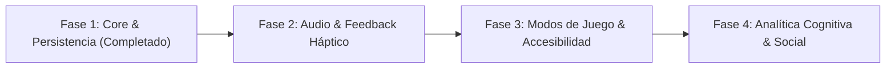

# Roadmap — Stroop Focus

Plan estratégico y fases evolutivas para el desarrollo de **Stroop Focus**.

---

## Fase 1: Arquitectura, Persistencia & Métricas Cognitivas *(Completada)*

- [x] Refactorización del controlador del juego a Riverpod `Notifier` desacoplado y seguro frente a fugas de memoria.
- [x] Persistencia local ligera con `shared_preferences` para récords personales (High Score).
- [x] Captura de métricas en tiempo real: tiempo de reacción promedio (ms) y precisión por congruencia (estímulo congruente vs. incongruente).
- [x] Estandarización visual con tokens de `ThemeData` y `ColorScheme` para soporte claro/oscuro.
- [x] Nuevos assets visuales nativos estilo arcade de 16-bit (App Icon y Splash Screen).

---

## Fase 2: Experiencia Sensorial & Sonido Retro *(En curso)*

- [ ] **Efectos de Audio Retro (8-bit / Chiptune)**:
  - Sonidos distintivos para: acierto regular, racha/combo, fallo/penalización, cuenta regresiva crítica (últimos 3 segundos), y fin de partida.
- [ ] **Retroalimentación Háptica**:
  - Micro-vibraciones en respuesta a gestos para reforzar la confirmación táctil inmediata.
- [ ] **Panel de Ajustes Rápidos**:
  - Modos de sonido activado/desactivado, volumen y alternancia de tema.

---

## Fase 3: Modos de Juego Alternativos & Accesibilidad *(Próximo Hito)*

- [ ] **Modos de Juego Diversificados**:
  - *Reverse Stroop*: Exige inhibición cognitiva inversa (responder la palabra y no el color).
  - *Time Attack / Sudden Death*: Máxima tensión para partidas rápidas.
  - *Zen / Relax*: Sin límite de tiempo, ideal para calentar o sesiones de baja presión.
- [ ] **Inclusión & Accesibilidad**:
  - Modos específicos para daltonismo (protanopía, deuteranopía, tritanopía) usando iconos distintivos además de colores.
  - Controles alternativos con botones fijos en pantalla para quienes prefieran toques a deslizamientos.

---

## Fase 4: Analítica Cognitiva Profunda & Funciones Sociales

- [ ] **Historial y Gráficas de Evolución**:
  - Visualización del progreso semanal/mensual del tiempo de respuesta y precisión mental.
- [ ] **Tarjetas de Rendimiento Compartibles**:
  - Generación de snapshot gráfico con estadísticas cognitivas para compartir récord personal.
- [ ] **Leaderboards Opcionales**:
  - Tabla de posiciones local y soporte opcional para tablas globales o de amigos.
