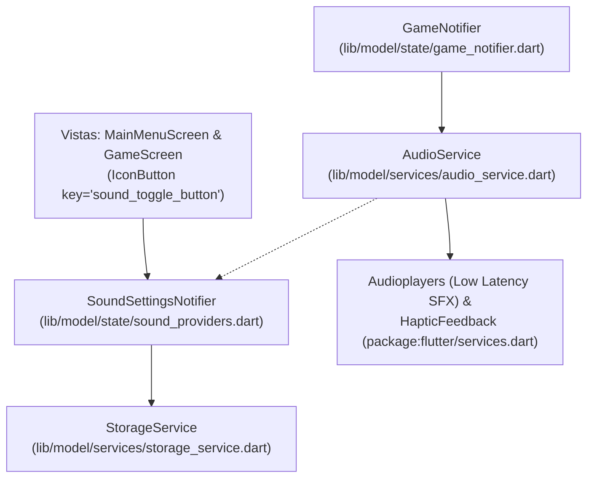

# Diseño Técnico: audio-and-haptics

---

## 1. Arquitectura y Capas

### 1.1 Capa de Servicios (`lib/model/services/`)
- **`StorageService` (`lib/model/services/storage_service.dart`)**:
  - `static const String keySoundEnabled = 'stroop_sound_enabled';`
  - `bool isSoundEnabled()`: retorna `_prefs.getBool(keySoundEnabled) ?? true`.
  - `Future<void> setSoundEnabled(bool enabled)`: guarda en SharedPreferences.
- **`AudioService` (`lib/model/services/audio_service.dart`)**:
  - Clase de servicio que encapsula la reproducción de clips locales y hápticos:
    - `Future<void> playCorrect()`
    - `Future<void> playIncorrect()`
    - `Future<void> playGameOver()`
    - `Future<void> playWarningTick()`
  - Gestiona `AudioPlayer` configurado con `PlayerMode.lowLatency`.
  - Consulta si el sonido está habilitado antes de reproducir o vibrar.
  - Implementa un método `dispose()` para liberar recursos.

### 1.2 Capa de Estado (`lib/model/state/`)
- **`SoundSettingsNotifier` (`lib/model/state/sound_providers.dart`)**:
  - Notifier que maneja el booleano `state = isSoundEnabled`.
  - Método `toggleSound()`: invierte el valor y llama a `storage.setSoundEnabled(state)`.
- **`audioServiceProvider`**:
  - Provider inyectado con `AudioService`, que puede ser sustituido en tests por un mock o implementación dummy (`FakeAudioService`) para que los tests corran de forma aislada sin requerir bindings de audio de plataforma.

### 1.3 Integración en `GameNotifier` (`lib/model/state/game_notifier.dart`)
- En `submitAnswer(Direction answered)`:
  - Si es correcto: invocar `audioService.playCorrect()`.
  - Si es incorrecto: invocar `audioService.playIncorrect()`.
- En `_onTick()`:
  - Si `timer == 0`: invocar `audioService.playGameOver()`.
  - Si `timer <= 3 && timer > 0`: invocar `audioService.playWarningTick()`.

### 1.4 Interfaz de Usuario
- **`MainMenuScreen` (`lib/screens/main_menu_screen.dart`)**:
  - Añadir un `IconButton` con `key: const Key('sound_toggle_button')` en la esquina superior (AppBar o Positioned) alternando `Icons.volume_up` y `Icons.volume_off`.
- **`GameScreen` (`lib/screens/game_screen.dart`)**:
  - Añadir el mismo botón interactivo en el header del juego para silenciar/activar durante la partida.

---

## 2. Assets de Audio

Ubicados en `lib/assets/audio/` y declarados en `pubspec.yaml`:
- `lib/assets/audio/correct.wav`: 8-bit blip ascendente (monoaural, 22kHz).
- `lib/assets/audio/incorrect.wav`: 8-bit buzz descendente de baja frecuencia.
- `lib/assets/audio/game_over.wav`: 8-bit jingle descendente de 3 notas.
- `lib/assets/audio/tick.wav`: 8-bit click corto de aviso.
