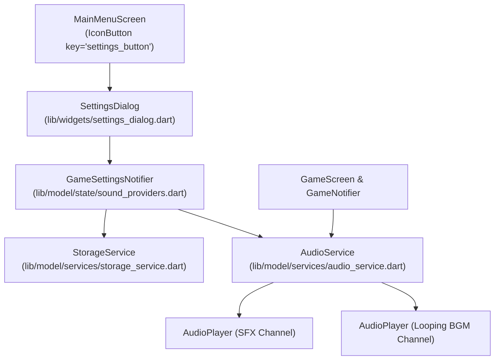

# Diseño Técnico: settings-and-arcade-polish

---

## 1. Arquitectura y Nuevos Componentes

### 1.1 Persistencia (`StorageService`)
Nuevas claves y métodos en `lib/model/services/storage_service.dart`:
- `static const String keyBgmEnabled = 'stroop_bgm_enabled';`
- `static const String keySfxVolume = 'stroop_sfx_volume';`
- `static const String keyBgmVolume = 'stroop_bgm_volume';`
- `static const String keyHapticsEnabled = 'stroop_haptics_enabled';`
- Métodos getters y setters con valores por defecto seguros (`bgmEnabled: true`, `sfxVolume: 1.0`, `bgmVolume: 0.6`, `hapticsEnabled: true`).

### 1.2 Servicio de Audio (`AudioService`)
Ampliación de `AudioService` y `DefaultAudioService` en `lib/model/services/audio_service.dart`:
- Dos instancias de `AudioPlayer`: `_sfxPlayer` y `_bgmPlayer`.
- Métodos de control de BGM:
  - `Future<void> startBgm()`
  - `Future<void> stopBgm()`
  - `Future<void> setBgmVolume(double volume)`
  - `Future<void> setSfxVolume(double volume)`
- Integración en `GameNotifier`: al iniciar la partida se invoca `startBgm()`, y en `_handleGameOver` o dispose se invoca `stopBgm()`.

### 1.3 Estado Reactivo (`GameSettings`)
Modelo inmutable y Notifier en `lib/model/state/sound_providers.dart`:
- `GameSettings`: clase inmutable con `sfxEnabled`, `sfxVolume`, `bgmEnabled`, `bgmVolume`, `hapticsEnabled`.
- `gameSettingsProvider`: Notifier que actualiza y sincroniza en tiempo real `StorageService` y `AudioService`.

### 1.4 Interfaz de Usuario
- **`SettingsDialog` (`lib/widgets/settings_dialog.dart`)**:
  - Diálogo modal con borde y sombra arcade.
  - Sliders para volúmenes con etiquetas numéricas o porcentuales.
  - Switches temáticos para activar/desactivar SFX, BGM y Hápticos.
- **`InstructionsDialog` (`lib/widgets/instructions_dialog.dart`)**:
  - Reemplazo de `GoogleFonts.inter` y colores hardcodeados.
  - Tarjetas con fondo oscuro y borde del color Stroop correspondiente (`Border.all(color: color, width: 2)`).
  - Título y textos con `GoogleFonts.pressStart2p`.
  - Botón arcade estilizado con `scale: 0.96` al presionar.

---

## 2. Pista de Audio BGM

- Ubicación: `assets/audio/bgm.wav`.
- Sintetizador: Melodía chiptune de 8 compases en escala pentatónica menor a 130 BPM con línea de bajo retro pulsante y arpegio superior, producida en mono a 22050 Hz en bucle continuo de 8 segundos (~350 KB).
